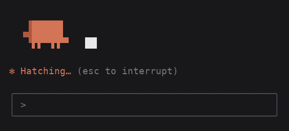
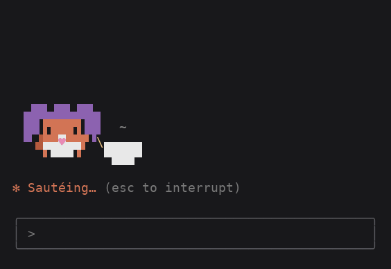

# clawd-actor

A Claude Code mod: while Claude works, **Clawd** walks onto a little stage above the prompt and
acts out what is going on — the spinner's `-ing` word (*Sautéing*, *Pondering*, *Herding*…) —
then puts on a show of 32 scenes, a new one every 15 seconds, with little Clawds along for the ride.



*Three scenes at the real frame rate, about 16 s in all (a real turn changes scene every 15 s). Every frame is the mod's own output, rendered by `tools/`.*

## What it does

- **Acts out the spinner word.** 32 scenes, matched by word stem, so *Flambéing* cooks and
  *Dilly-dallying* strolls. A word it does not know falls back to what the turn is doing
  (typing for tool use, talking while responding, thinking otherwise).
- **Acts out the running tool** when one is already running as a turn opens; it picks the
  opening scene instead of the word: `Bash` types, `Read`/`Grep`/`Glob` think, `Edit`/`Write` sketch, `Agent` herds sheep,
  `Web*` checks the weather, `TodoWrite`/`Skill` juggles, MCP tools cast spells, anything else is
  hammered at the forge.
- **Changes scene every 15 seconds** on long turns, whatever tools run, in an order shuffled per
  session that picks up where the last turn stopped, never the same scene twice in a row. A scene
  is picked when its act begins and holds for the whole act; nothing cuts it short.
- **Wanders the stage.** When all it carries is a thought bubble, notes or sparks, Clawd strolls
  left and right, swinging arms and legs, hopping at each turn and landing with a squash. By a pot,
  an oven, an anvil or a plant it stays put and works; the stage follows the terminal width (up to
  60 columns). At the blackboard the board stays put and Clawd steps back to admire its work. By the
  campfire it sits still with a purple friend, and only the fire and their eyes move. Under the
  disco ball it dances in place while the floor flashes.
- **Brings little friends.** Small Clawds in blue, yellow, green and pink tag along: one copies
  its idle hop a beat late, two dance backup, one dances under the disco ball, two walk in a row
  behind it (and lead the way back), two sit by the campfire when the stage is wide enough, and
  one hatches from the egg, stands in its shell and hops out to say hello.
- **Dresses for the part.** Thinking (and reading or searching files), it is a detective in a
  fedora with a magnifying glass in hand; kicking, a footballer in a blue number 10 shirt and a
  headband; levitating, an astronaut in a glass helmet with an oxygen tank; cooking or baking, a
  homemaker with a big curly perm and a heart-pocket apron. It conjures in a wizard's pointed hat
  and beard, herds in a cowboy hat and neckerchief, sketches in a beret with a palette, lectures in
  a mortarboard, spins records under the disco ball in headphones and juggles as a clown with a red
  nose. The stage keeps its top row for the hats, so they stay on when Clawd hops.
- **Has a face.** Happy ^ ^ eyes, blinks, glances around, and sways so its far side falls into
  shadow, after the official Clawd animation; on the move it looks where it is going.
- **Talks back.** `/clawd` pets, feeds or waves at Clawd, or chats with it, even mid-turn (see
  below).
- **Keeps your notebook.** `/clawd note`, `todo`, `plan`, `done` and `remind` jot thoughts,
  todos for later, the day's plan (with suggestions from what is waiting) and today's reminders into a markdown file you (or Claude) can read; Clawd calls a
  reminder out five minutes ahead and when it is due.
- **Hands out badges.** Eleven to collect, from saying hello to a ten-minute turn or a week in a
  row; Clawd cheers each one as you earn it, and `/clawd badges` shows the shelf.
- **Leaves when the turn ends**, and draws nothing while idle (the frame timer only redraws
  during a turn), unless you call it out with `/clawd`.

| Scene | Spinner words (some of them) |
| --- | --- |
| think | Pondering, Musing, Clauding, Noodling, Ruminating |
| chalk | Deciphering, Elucidating, Philosophising, Deliberating, Reasoning |
| cook / bake / brew | Sautéing, Simmering, Whisking / Baking, Kneading / Brewing, Percolating |
| walk / run / moonwalk | Moseying, Wandering / Scampering, Galloping / Moonwalking |
| herd | Herding, Wrangling, Mustering |
| spin | Spinning, Churning, Reticulating, Combobulating |
| magic / levitate | Conjuring, Manifesting, Transmuting / Levitating, Hyperspacing |
| hatch / grow | Hatching, Incubating / Sprouting, Germinating |
| forge / compute | Forging, Crafting, Creating / Computing, Crunching, Synthesizing |
| dance / disco | Vibing, Jitterbugging, Jamming / Boogieing, Grooving — under a spinning mirror ball |
| juggle / honk | Juggling / Honking, Booping |
| sketch / weather / thunder | Sketching, Doodling / Misting, Billowing / Thundering |
| dig / flow | Burrowing, Spelunking / Flowing, Undulating |
| shift | Beaming, Shifting, Dodging — calls out 閃身步 top to bottom, then flashes across the stage leaving fading afterimages |
| kick / skate / campfire | Kicking, Dribbling / Skating, Gliding / Kindling, Smoldering — no built-in word matches these yet, so they mostly turn up in the rotation |

## Talk to Clawd

`/clawd` runs at once, even while Claude is working, and never interrupts the turn:



*Clawd's answer here is an example; in a session it comes from Haiku.*

| You type | Clawd |
| --- | --- |
| `/clawd pet` | purrs, with hearts floating up |
| `/clawd feed` | catches a cookie and munches it |
| `/clawd wave` (or `hi`, `hello`) | waves back |
| `/clawd dance` | dances under the disco ball |
| `/clawd shift` (or `閃身步`) | calls out 閃身步 and flash-steps across the stage, afterimages trailing |
| `/clawd <anything else>` | answers in a speech bubble |

Actions are free and instant. Anything else is a chat: Clawd ponders for a moment, then answers in
a sentence or two, in your language, knowing what Claude is up to right now. The answer comes from
Haiku (one small `haiku` call per message, on your usage) and shows only in Clawd's bubble: it is
not written to the transcript, so Claude's own conversation never sees it. Each message stands
alone; Clawd does not remember earlier ones. Between turns Clawd steps out for the reaction and
leaves again after it.

### The notebook

| Command | What it keeps |
| --- | --- |
| `/clawd note <text>` | a line under today's notes, with the time |
| `/clawd todo <text>` | a todo for some day, into the inbox at the top of the file |
| `/clawd plan a; b; c` | todos for today, added to the list |
| `/clawd plan` | Clawd suggests up to three todos for today, from the inbox and what earlier days left open |
| `/clawd plan ok [1 3]` | takes the suggestions on (all, or the ones numbered): onto today's list, ticked where they came from |
| `/clawd done [n]` | ticks off todo `n`, or the next open one; Clawd dances, and all done brings out the disco ball |
| `/clawd list` | today's todos, numbered, and the reminders still to come, in the bubble |
| `/clawd remind 14:00 standup` (or `14：00`, `30m`, `45min`, `1h30m`, `30分`, `1小時30分`) | a reminder for later today |

The commands are English; what you write can be any language. Clawd answers in Chinese when what
it is about is Chinese (your text, or for `list`, `done` and `plan` the notebook), in English
otherwise. The notebook's headings stay English either way.

All of it goes to `~/.claude/clawd-notes.md`, a heading a day, so you can read and edit it yourself
or ask Claude to plan your day from it:

```markdown
# Inbox

## Todo
- [ ] look into automating the restack
- [x] reply to PM → 11-14

# 2026-11-14

## Notes
- 10:32 ask PM about the field definitions

## Todo
- [x] write the tests
- [ ] ship it
- [ ] reply to PM

## Reminders
- [ ] 14:00 standup
```

`/clawd plan` with nothing after it asks Haiku (one small `haiku` call) to choose from the open
todos, with today's reminders in view. Haiku answers only with their numbers, so every suggestion
is a todo you wrote; when it does not answer, the oldest are offered. For a whole day laid out
with times, ask Claude itself to plan it from the notebook.

Clawd checks the reminders every 30 seconds: five minutes ahead it honks with the reminder in a
bubble and a toast, and again when it is due, then ticks it off, so another open session does not
call it twice. A turn now and then (at most every half hour) opens with the next open todo in
Clawd's bubble. Reminders only work while Claude Code is open, and only show inside it: they keep
you on time while you code, they are not a calendar.

### Badges

| Badge | How |
| --- | --- |
| Hello there | say anything to Clawd |
| Best friends | pet Clawd 100 times |
| Cookie monster | feed Clawd 50 cookies |
| Scribe | write 20 notes |
| Finisher | tick off 50 todos |
| Clean slate | finish all of a day's todos, 3 or more |
| On time | set 10 reminders |
| Marathon | a turn of 10 minutes: Clawd runs and walks in a red headband and a 42 race bib from then on |
| Busy bee | 50 turns in a day |
| Regular | 7 days in a row |
| Night owl | a turn between midnight and 4 a.m. |

Earning one brings Clawd out under the disco ball with a toast; a badge with a costume shows it
off in its own scene instead. Costumes come one badge at a time: so far, Marathon's. `/clawd badges` shows how many you
have and the closest one still to go, with its count. The counts are Clawd's own (kept in the
mod's store, not the notebook) and the same in every project; only your own turns count, not a
subagent's.

### 閃身步 (shift)

閃身步, the *flash step*, is a martial-arts dodge: a burst of speed that carries the fighter aside
so fast the eye catches only afterimages. Clawd does it as a proper move, name first:

```
閃
身  ▓▓▓▓▓▓▓ ▓▓▓▓▓▓▓  ▐▛███▛▌
步 ▓▓▓▓▓▓▓▓▓▓▓▓▓▓▓▓▓▝▜█████▙▖
     ▓▓ ▓▓   ▓▓ ▓▓
```

1. **Calls the move.** 閃, 身, 步 appear one at a time, top to bottom in a column behind Clawd,
   the way `< HONK! >` is shouted, while Clawd looks the way it is about to go.
2. **Takes its stance**, arms up, once the name is complete.
3. **Flashes across the stage** in three frames, leaving an afterimage at each spot it left.
4. **Lands sliding** with a squash; the afterimages fade (▓ ▒ ░) and are gone, and Clawd hops
   with a pleased smile.

Then it calls the move again and flashes back the other way, about three seconds a pass.
`/clawd shift` or `/clawd 閃身步` plays it at once, from the call; as a scene it comes with the
spinner word *Beaming*, and in the rotation. It needs a terminal font that draws CJK characters two
columns wide, as nearly all do.

## Install

Requires a Claude Code build with function-hook mods (`claude plugin validate` knows `hooks.json`
`modules`). Developed and tested on Claude Code 2.1.296.

Clawd shows in `claude` in any terminal (including an editor's terminal and the JetBrains plugin),
in the Code tab of the Desktop app and in the VS Code chat panel. Outside a terminal the stage is drawn
as an SVG, since text there is proportional and its rows would drift apart. `claude -p` and cloud
sessions draw no mod interface, so Clawd does not show there.

From this repository as a marketplace:

```
/plugin marketplace add BrianHuang813/clawd-actor
/plugin install clawd-actor@clawd-actor
/reload-plugins
```

Or straight from a clone, for one session:

```sh
git clone https://github.com/BrianHuang813/clawd-actor
claude --plugin-dir ./clawd-actor
```

## Update

When a newer version is out, a notice says so a couple of seconds after Claude Code starts: the
mod compares its own version with the one on `main` once a session (one small request to GitHub;
nothing is shown when offline or up to date).

Run `/clawd-actor:update`, or just ask Claude to update clawd-actor. Either way Claude refreshes
this marketplace and updates the plugin with Claude Code's own plugin manager, tells you the
version it went from and to and sums up what is new, and `/reload-plugins` loads it. However it
was updated, the first session on a new version says so in a notice, with the release's headline
and a link to the release notes. By hand, the same is:

```sh
claude plugin marketplace update clawd-actor
claude plugin update clawd-actor@clawd-actor
```

A clone run with `--plugin-dir` updates with `git pull`.

## Plays well with other band mods

The stage is drawn in the `AbovePrompt` band. The hook always calls `next(e)` and stacks what the
mods beneath it draw under the stage, so other band mods keep showing. It hands them the band's
rows less the ones the stage and bubble take, so together they still fit without scrolling, and
when the band is too short for the stage Clawd stays out. A band mod that answers
without calling `next(e)` hides everything beneath it — if Clawd never shows up, look for one.

## How it works

- `ui.render` on `Spinner` only *observes*: it remembers the word and mode and lets the engine draw
  the spinner as usual.
- `tool.call` notes the tool in flight and forgets it when the call returns.
- `/clawd` is registered `immediate`, so it runs mid-turn. Its `command.run` hook returns no text
  (nothing for the transcript or the model); it sets a reaction the band plays over the show. A
  chat calls `$.model.complete` from a one-shot timer, so the prompt never waits on the model.
  `hooks/chat.ts` holds the parsing, Clawd's persona and the speech bubble.
- One timer, started in `session.start`, advances a frame counter in `$.state` every 140 ms while a
  turn runs; the band reads it, which subscribes it to redraws. A timer started inside a
  `turn.start` hook does not outlive that dispatch, which is why it lives in `session.start`.
- Whether to draw at all follows the band's own `isWorking` prop.
- `hooks/scenes.ts` is pure: a 5-row grid of cells (the top one for hats), a scene per name, a costume per
  dressed-up scene drawn over Clawd wherever it stands, `sceneAt()` choosing an
  act's scene, `hold()` keeping it for the whole act, and `frameRows()` turning the grid into
  coloured runs.
- The update notice: `session.start` sets a one-shot timer that, two seconds later, reads the
  version in the installed `plugin.json`, fetches the one on `main`, and toasts when `main`'s is
  newer. `skills/update/SKILL.md` is the `/clawd-actor:update` skill that runs the update.

## Contributing

Bug reports, ideas and new scenes are welcome: see [CONTRIBUTING.md](CONTRIBUTING.md) for how to
report a bug, run Clawd from a clone, test a change, regenerate the GIFs and send a pull request.

## Notes

Clawd is Claude Code's mascot; the sprite follows the one on Claude Code's welcome screen. This is
a fan-made mod, not affiliated with or endorsed by Anthropic.
